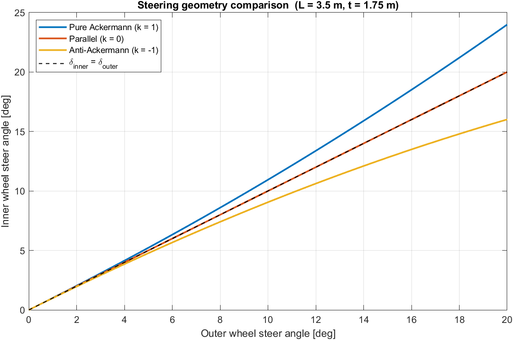
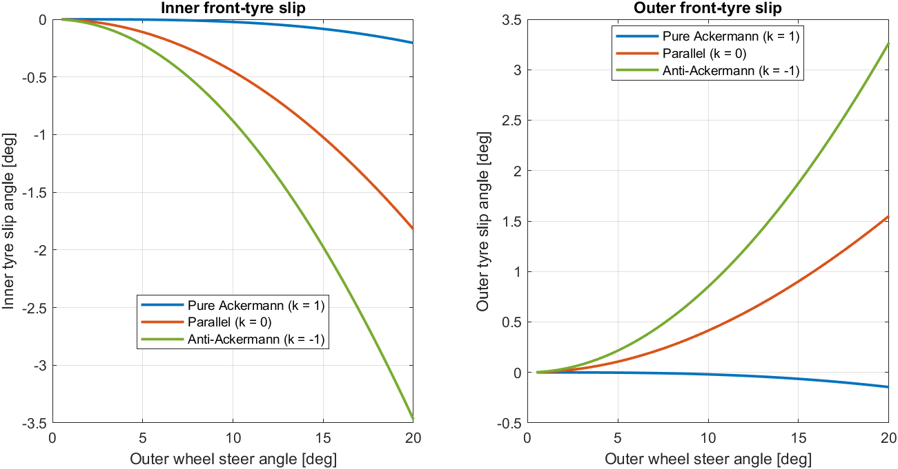
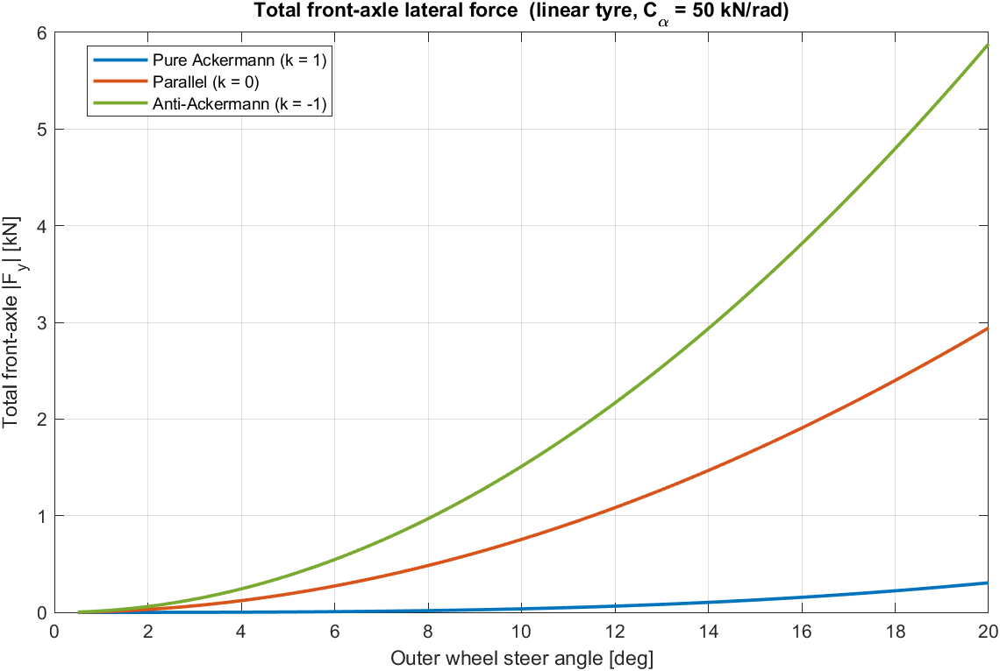
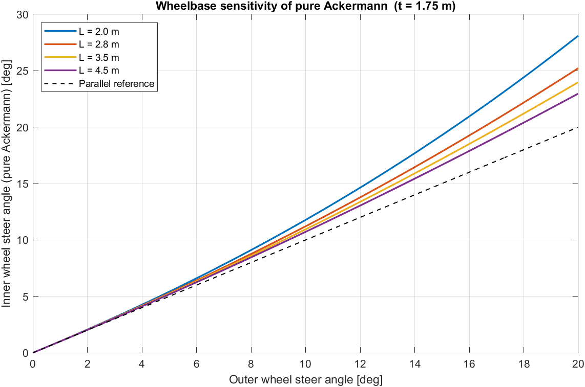

# Ackermann Steering Geometry — MATLAB

[](https://github.com/jaykumarpatil9099/ackermann-steering-analysis/actions/workflows/ci.yml)
[](https://matlab.mathworks.com/open/github/v1?repo=jaykumarpatil9099/ackermann-steering-analysis)

[](LICENSE)

Analytical study of front-axle steering geometry for a four-wheel vehicle. Compares **pure Ackermann**, **parallel**, and **anti-Ackermann** linkages on three axes:

- The geometric inner-vs-outer wheel angle relationship
- Tyre slip angles developed under each geometry in a low-speed kinematic turn
- Resulting lateral tyre forces under a linear tyre model

Originally built during the Vehicle Dynamics Modelling and Simulation course at Hochschule Trier; this repository is a clean re-implementation in pure MATLAB with the methodology and results preserved. Pairs with the [vehicle dynamics models toolkit](https://github.com/jaykumarpatil9099/vehicle-dynamics-models-matlab-simulink) (which contains the underlying multi-DoF vehicle models) and the [GT3 Lap Time Simulator](https://github.com/jaykumarpatil9099/gt3-lap-time-simulator).

## What it shows

### Inner vs outer wheel angle

The three geometries differ in how the inner wheel responds when the outer wheel is steered:

- **Pure (100 %) Ackermann** — `δ_inner` follows the geometric ideal so both wheels roll without slip in a low-speed turn.
- **Parallel (0 %)** — `δ_inner = δ_outer`. Common in some early road cars; both wheels carry slip.
- **Anti-Ackermann (-100 %)** — inner wheel is steered *less* than the outer. Standard in pure-race cars where lateral load transfer makes the outer tyre the dominant force generator.



### Slip angles per tyre

At low speed, pure Ackermann yields zero slip on both front tyres. Parallel and anti-Ackermann geometries develop opposite-sign slip on the two tyres — inner tyre under-steered, outer tyre over-steered.



### Lateral tyre force

Combining the slip angles with a linear tyre model (`F_y = -C_α · α`, `C_α = 50 kN/rad`) gives the total cornering force generated by the front axle under each geometry. Anti-Ackermann delivers the most front-axle force at low to moderate steering inputs, at the cost of the inner tyre developing meaningful slip and scrub.



### Wheelbase sensitivity

Pure Ackermann depends on the wheelbase-to-track ratio. Longer wheelbases push the curve closer to parallel for the same outer-wheel angle — a sedan and a sports car of the same track width need very different linkages to achieve the same Ackermann percentage.



## Methodology

Pure Ackermann inner-wheel angle, derived from the geometric requirement that both wheels trace concentric arcs around a single instantaneous turn centre:

```
δ_inner_pure = atan( L / ( L / tan(δ_outer) - t ) )
```

where `L` is wheelbase and `t` is front track width. The geometry is parametrised by an Ackermann fraction `k`:

```
δ_inner = δ_outer + k · ( δ_inner_pure - δ_outer )
```

- `k = 1.0` reproduces pure Ackermann
- `k = 0.0` gives parallel steering
- `k = -1.0` gives "100 % anti-Ackermann" (mirror of pure across the parallel reference)

For the slip-angle analysis the vehicle's instantaneous turn radius is taken from the mean front-axle steer angle (the bicycle-model interpretation):

```
R = L / tan( (δ_inner + δ_outer) / 2 )
```

Each tyre's slip is the deviation between its actual steer angle and the kinematic ideal at that radius:

```
slip_inner = δ_inner_actual - atan( L / (R - t/2) )
slip_outer = δ_outer_actual - atan( L / (R + t/2) )
```

Lateral force per tyre uses the linear model `F_y = -C_α · α`, valid in the small-slip regime (typically below ~3°). Outside that range a non-linear tyre model (e.g. Pacejka Magic Formula, available in the [VD models repo](https://github.com/jaykumarpatil9099/vehicle-dynamics-models-matlab-simulink)) is required.

## Engineering note — why race cars use anti-Ackermann

Lateral load transfer in a high-speed corner shifts vertical load from the inner tyre to the outer tyre. The outer tyre, now carrying most of the weight, can develop more lateral force per degree of slip and reaches its peak at a higher slip angle than the lightly loaded inner. Pure Ackermann steers the inner tyre to a *larger* angle than the outer — but in a high-speed corner the outer is the tyre doing the work. Anti-Ackermann inverts the relationship: the outer wheel is steered more aggressively, putting the more-loaded tyre closer to its peak slip while accepting that the inner tyre operates sub-optimally.

The trade-off is at low speed (parking, pit lane, slow chicanes) where anti-Ackermann produces meaningful tyre scrub and tight-radius handling penalties. The choice is therefore application-specific — a pit-lane car wants Ackermann, a hot-lap car wants anti, and a road car compromises somewhere in between.

## Default parameters

Default vehicle parameters describe a formula-class car, consistent with the 14-DoF model in the [VD models repo](https://github.com/jaykumarpatil9099/vehicle-dynamics-models-matlab-simulink):

| Parameter | Value |
|---|---|
| Wheelbase `L` | 3.5 m |
| Front track `t` | 1.75 m |
| Steering ratio | 20 deg/deg |
| Cornering stiffness `C_α` | 50 kN/rad per tyre |

## Quick start

In MATLAB R2023b or newer, or with *Open in MATLAB Online* above (a free MathWorks account is enough):

```matlab
buildtool            % static code analysis + unit tests
buildtool figures    % regenerate the README figures
```

The test suite checks the classic Ackermann condition `cot δo − cot δi = t / L`, the parallel and anti-Ackermann parametrisation, near-zero slip for pure Ackermann, and the SAE/ISO tyre sign convention. It runs in GitHub Actions on every push.

## File layout

```
ackermann-steering-analysis/
├── parameters.m                 # vehicle parameters (formula-class default)
├── src/
│   ├── ackermann_curves.m       # inner-angle parametrisation (k_ackermann)
│   ├── slip_angle_calc.m        # tyre slip from kinematic R
│   └── tyre_lateral_force.m     # linear-tyre lateral force
└── figures/
    ├── plot_geometry_comparison.m
    ├── plot_slip_and_forces.m
    └── plot_parametric_sweep.m
├── tests/AckermannTest.m        # matlab.unittest suite
├── buildfile.m                  # MATLAB build tool: check, test, figures
└── .github/workflows/ci.yml     # CI on every push
```

## Background

Originally built during the Vehicle Dynamics Modelling and Simulation course of the M.Sc. Interdisciplinary Engineering (Automotive) programme at [Hochschule Trier](https://www.hochschule-trier.de/).

## License

MIT. See `LICENSE`.
